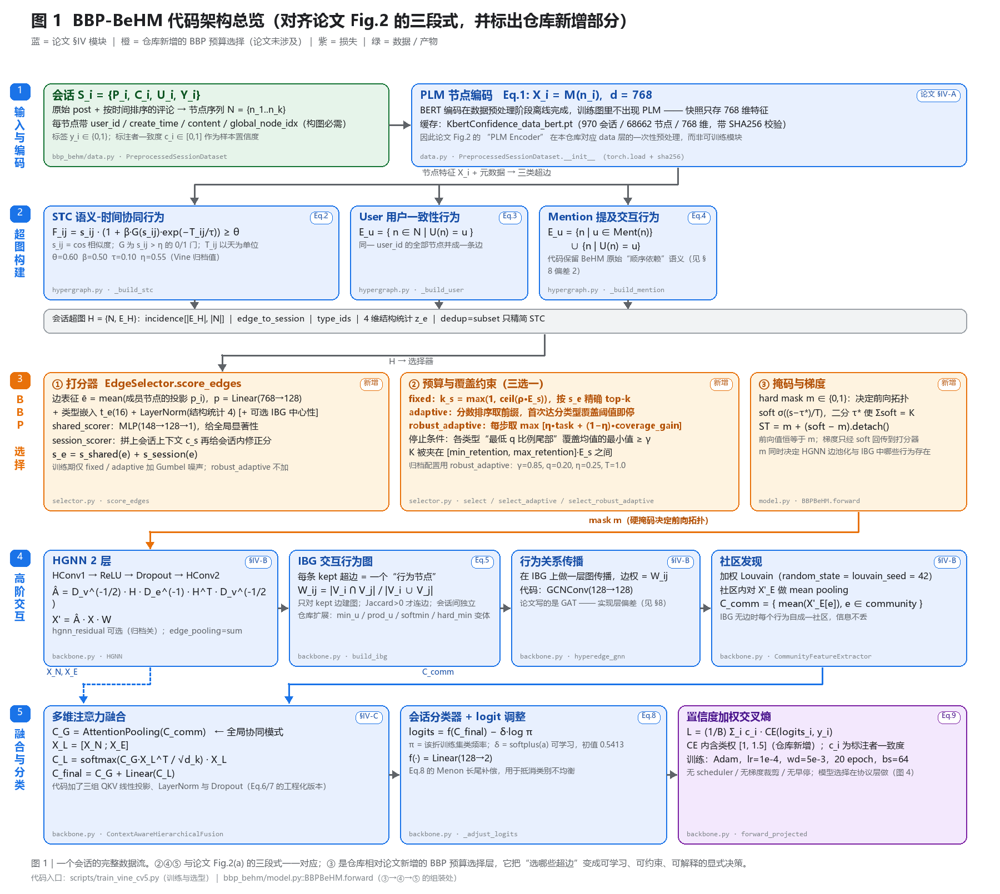
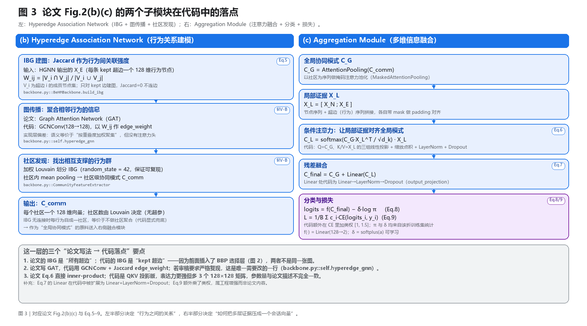
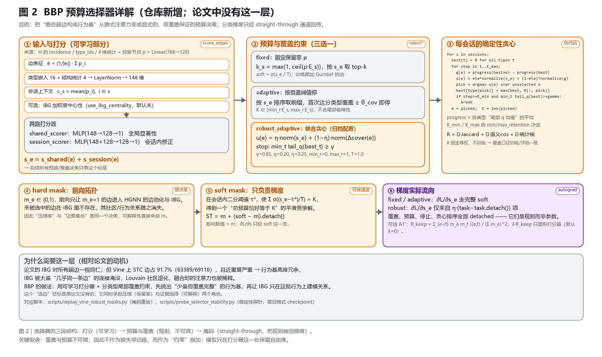
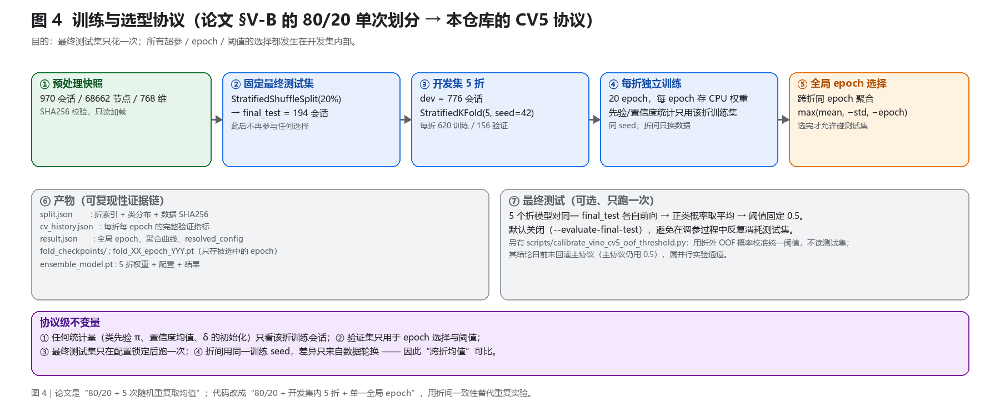

# BBP-BeHM 架构说明（代码 ↔ 论文逐条对照）

> 对应论文：`docs/Paper3008#Behavior-driven Hypergraph Modeling for Accurate Cyberbullying Detection in Social Media.pdf`
> 对应代码：`bbp_behm/`（模型库）+ `scripts/`（训练与实验入口）
> 图：`docs/figs/fig1~fig4`，由 `docs/figs/make_figs.py` 生成（可重跑）。

---

## 0. 一句话概括

仓库 = **论文 BeHM 的三段式主干**（超图构建 → 高阶交互建模 → 多维融合分类）**+ 一个论文没有的第四段：BBP 预算选择层**。
主干严格按 Fig.2(a)(b)(c) 与 Eq.1–9 实现；第四段把“保留哪些超边作为行为基”变成显式、带覆盖保证的决策，并让分类损失通过 straight-through 掩码回传给打分器。

- 参数量（hidden=128，按当前归档配置静态计算）：**约 0.29M**，其中主干约 0.231M、选择器约 0.055M。
- 仅支持 `dataset=vine`（另有 `ins` 分支但未接数据）；二分类会话级检测。

---

## 1. 总览



一条会话的数据流：

```
会话 S_i ──PLM(离线)──> 节点特征 X_i∈R^768
        └─超图构建(Eq.2/3/4)──> H = {N, E_H}（三类超边 + incidence）
                              └─BBP 选择（新增）──> 掩码 m
                                                    └─HGNN──> X_N, X_E
                                                              └─IBG(Eq.5)+GCN+Louvain──> C_comm
                                                                                        └─融合(Eq.6/7)──> C_final──> logits(Eq.8)──> L(Eq.9)
```

---

## 2. 模块一：输入与超图构建（论文 §IV-A，Eq.1–4）

### 2.1 输入与节点特征（Eq.1）

论文用 PLM 在线编码 `X_i = M(n_i)`。**本仓库把这一步前移到数据预处理**：快照文件里直接存 768 维 BERT 特征，训练图里没有任何 PLM 参数。

- 代码：`bbp_behm/data.py::PreprocessedSessionDataset`（`torch.load` + SHA256/形状校验）
- 规模：970 会话 / 68662 节点 / 768 维
- 每个节点必须带 `global_node_idx / user_id / create_time / content`，否则构不出超边（STC 用时间与语义，User 用 user_id，Mention 用 content 里的 `@userN`）。

### 2.2 三类超边（每条超边 = 一种群体行为）

| 类型 | 论文 | 代码 | 归档参数 |
|---|---|---|---|
| STC 语义-时间协同 | Eq.2 | `hypergraph.py::_build_stc` | θ=0.60, β=0.50, τ=0.10, η(gate)=0.55 |
| User 用户一致性 | Eq.3 | `_build_user` | — |
| Mention 提及交互 | Eq.4 | `_build_mention` | — |

**STC**：先算两两语义相似度 `s_ij = cos(X_i, X_j)`，再按

```
F_ij = s_ij · (1 + β · G(s_ij) · exp(−T_ij / τ))，  G(s_ij)=1[s_ij > η]
```

融合时间邻近性。构造方式与论文一致：**以每个节点 i 为中心**，把所有 `F_ij ≥ θ` 的节点组成候选边 `E_STC,i`（成员数 < 2 丢弃）；成员集合完全相同的候选合并为一条，`construction_strength` 取平均、`duplicate_count` 记多源命中次数。

> `T_ij` 在代码里按 `|Δt| / time_window_seconds` 归一，`time_window_seconds=86400` 时即为“天”，与论文取 τ=0.1 的口径一致。

**User**：同一 `user_id` 的全部节点并成一条边（Eq.3 的直接翻译）。

**Mention**：正则 `@(user\d+)` 抽被提及用户；代码额外保留 BeHM 原始实现的**顺序依赖**——按时间序遍历，若某节点的作者此前已被提及，则该节点并入该作者的提及边。严格说这小于 Eq.4 的并集语义（见 §8 偏差 2）。

### 2.3 构建后的超图对象

`HyperedgeBuilder.build_batch` 把一个 batch 内的会话各自建图后拼成：

| 字段 | 形状 | 用途 |
|---|---|---|
| `incidence` | `[|E_H|, N]` 0/1 | HGNN、IBG、覆盖计算 |
| `edge_to_session` | `[|E_H|]` | 会话归属 |
| `type_ids` | `[|E_H|]` | 类型嵌入、分类型覆盖 |
| `structural_stats` | `[|E_H|, 4]` | `[log1p(size), strength, log1p(time_span_days), log1p(unique_users)]` |
| `records` | list | 保留成员、来源、强度等，供解释导出 |

构建段可选去冗余（论文没有）：`dedup_mode = none | subset | jaccard`，**只作用于 STC**。`subset` 剔除成员集合被其它 STC 边严格包含的边；`jaccard` 在 `Jaccard ≥ dedup_jaccard_tau` 时保留 `construction_strength` 更高者。归档配置用 `subset`。

---

## 3. 模块二：高阶交互建模（论文 §IV-B，Eq.5）



### 3.1 HGNN

2 层超边卷积，代码即标准 HGNN：

```
 = D_v^(-1/2) · H · D_e^(-1) · H^T · D_v^(-1/2)
X' = Â · X · W            （HConv1 → ReLU → Dropout → HConv2）
X_E = H^T · X_N           （edge_pooling=sum；可切 mean）
```

- `hgnn_residual` 可加残差+LayerNorm（归档关闭）。
- 输出 `X_N`（节点）与 `X_E`（超边 = 行为表示）。

### 3.2 IBG（Interaction Behavior Graph）

把每条**被保留的**超边当作一个“行为节点”，行为间关联强度用 Jaccard（Eq.5）：

```
W_ij = |V_i ∩ V_j| / |V_i ∪ V_j|
```

代码：`build_ibg`，只对 `Jaccard > 0` 的边对建（双向）边，`edge_weight = W_ij`。仓库另加了若干降权变体（`min_u / prod_u / softmin / softprod / hard_min`，见配置 `ibg_weight_mode`），默认仍用 `jaccard`，即论文口径。

### 3.3 行为关系传播 + 社区发现

- 论文写 **GAT**；代码用 **`GCNConv(128→128)` + `edge_weight=W_ij`**（`backbone.py::hyperedge_gnn`）。语义是“按行为重叠度加权聚集”，但没有注意力头 —— 这是与论文唯一的实质性实现偏差。
- 然后对 IBG 跑**加权 Louvain**（`random_state=louvain_seed`，保证可复现），社区内对 `X'_E` 做 mean pooling，得到社区级协同模式 `C_comm`。
- 边界兜底：会话内没有 IBG 边时，每个行为自成一社区（等价于不做社区聚合），信息不丢。

---

## 4. 模块三：多维注意力融合与分类（论文 §IV-C，Eq.6–9）

```
C_G    = AttentionPooling(C_comm)              # 全局协同模式（社区序列上的掩码注意力池化）
X_L    = [X_N ; X_E]                            # 局部证据：节点 + 行为
C_L    = softmax(C_G · X_L^T / √d_k) · X_L      # Eq.6：条件注意力
C_final= C_G + Linear(C_L)                      # Eq.7：残差融合
logits = f(C_final) − δ · log π                 # Eq.8：Menon 长尾 logit 调整
L      = (1/B) Σ_i c_i · CE(logits_i, y_i)      # Eq.9：置信度加权交叉熵
```

代码实现要点：

- 注意力是 **QKV 投影版**：`Q=C_G`、`K/V=X_L` 各一组 `Linear(128,128)`，缩放点积后 LayerNorm + Dropout，再与 `C_G` 相加后过 `Linear+LN+Dropout`。
- `π` 是**该折训练集**的类频率（`class_priors`）；`δ = softplus(a)` 保证为正，`a` 初值 0.5413（softplus≈1）。
- `c_i` 来自数据快照的 `confidence`；`confidence_weighting = raw | class_normalized | none`。
- CE 里额外挂类权 `[1, positive_class_weight]`（归档 1.5），论文没有这一项（见 §8 偏差 4）。

---

## 5. 仓库新增：BBP 预算选择（论文没有）



### 5.1 动机

Vine 上 STC 边占 91.7%（63389/69116），且近重复严重。论文的 IBG 对所有超边一视同仁，于是“几乎同一条边”的大量连接会淹没行为关系、让 Louvain 社区退化、稀释融合注意力。BBP 的思路：**先用可学习打分器 + 分类型尾部覆盖约束，挑出“少量但覆盖完整”的行为基，再让 IBG 只在这批行为上建模关系**。它同时承担压缩（保留率）与证据选择（可解释）两个角色。

### 5.2 打分（唯一可学习部分）

```
边表征  ē = mean(p_i),  p = Linear(768→128)（共享编码器）
特征    [ē ; type_emb(16) ; LayerNorm(stats 4) (+ IBG 中心性)]  → 148 维
shared_scorer : MLP(148→128→1)         全局显著性
session_scorer: MLP(148+128→128→1)     拼会话上下文后的会话内修正
s_e = shared + session
```

### 5.3 三种预算模式

| 模式 | 规则 | 用途 |
|---|---|---|
| `fixed` | `k_s = max(1, ceil(ρ·E_s))`，按 `s_e` 精确 top-k | 固定压缩率基线 |
| `adaptive` | 按 `s_e` 排序取前缀，首次达“分类型等权覆盖 ≥ θ_cov”即停 | 覆盖驱动，但无尾部保证 |
| `robust_adaptive` | 每步 `u(e)=η·norm(s_e)+(1−η)·norm(Δcoverage)` 贪心；停止条件 = 各类型“最低 q 比例尾部均值”的**最小值** ≥ γ | 归档配置（γ=0.85, q=0.20, η=0.25） |

覆盖不是在边集合上直接算，而是在**同类型代表矩阵 R** 上算：

```
R = ⅓·Jaccard(结构) + ⅓·语义cos + ⅓·exp(−|z_e−z_f|)(统计核)
```

三核等权、不训练 → 覆盖口径在训练/评估之间完全一致。

### 5.4 掩码与梯度

```
hard m ∈ {0,1}                  前向拓扑（HGNN 边池化、IBG 建图都只看 m=1）
soft σ((s−τ*)/T)，二分解 τ* 使 Σsoft = K
ST = m + (soft − m).detach()    前向值 = m，梯度只经 soft
```

因此：**覆盖、预算、停止规则、贪心排序全部 detached，是规则而非参数**；模型只在打分器处保留自由度。`robust` 模式下 `∂L/∂s_e` 只来自 `η·(task − task.detach())` 一项。

可选的 A1′ 正则（默认 `redundancy_lambda=0` 关闭）：

```
R_keep = Σ_{e<f} m_e m_f J(e,f) / (Σ_e m_e)^2      L += λ · R_keep
```

它用 `projected_nodes.detach()` 重算分数，所以**只塑造打分器、不回传编码器**（模块解耦，便于归因）。

---

## 6. 训练与选型协议



论文是 “80/20 划分 + 5 次随机重复取均值”；代码改成 **“80/20 + 开发集内 5 折 + 单一全局 epoch”**，用折间一致性替代重复实验：

1. `StratifiedShuffleSplit(20%)` 切出固定最终测试集（194 会话），剩余 776 会话作为开发集；
2. 开发集做 `StratifiedKFold(5, seed=42)`，每折 620 训练 / 156 验证；
3. 每折独立训练 20 epoch，**每 epoch 都 clone 一份 CPU 权重**；先验、置信度统计、`louvain_seed` 等只用该折训练会话；
4. 跨折按同一 epoch 聚合验证指标，按 `(均值↑, 标准差↓, epoch↓)` 选**一个全局 epoch**；
5. 只保存该 epoch 的 5 个 fold checkpoint；
6. 最终测试默认不跑；开启后 5 个模型各自前向，正类概率平均，阈值固定 0.5。

不变量：任何统计量只看训练折；验证集只用于选 epoch；测试集只花一次；折间同 seed，差异只来自数据轮换。

---

## 7. 代码地图

| 论文位置 | 代码文件 | 说明 |
|---|---|---|
| Fig.2(a) 输入、Eq.1 | `bbp_behm/data.py` | 快照加载、会话切片、collate、分层切分 |
| Eq.2 / Eq.3 / Eq.4 | `bbp_behm/hypergraph.py` | `_build_stc` / `_build_user` / `_build_mention`；`build_batch` 组装 |
| —— | `bbp_behm/config.py` | INI → 6 个 frozen dataclass + 全量校验 |
| **新增** 选择器 | `bbp_behm/selector.py` | `score_edges`、三种 `select*`、代表矩阵、鲁棒贪心 |
| **新增** 组装 | `bbp_behm/model.py` | `BBPBeHM.forward`：selector → masked incidence → backbone；A1′ |
| HGNN / IBG / GCN / Louvain | `bbp_behm/backbone.py` | `HGNN`、`build_ibg`、`hyperedge_gnn`、`CommunityFeatureExtractor` |
| Eq.6 / Eq.7 | `backbone.py::ContextAwareHierarchicalFusion` | 掩码注意力池化 + 条件注意力 + 残差 |
| Eq.8 | `backbone.py::_adjust_logits` | `logits − softplus(a)·log π` |
| Eq.9 | `backbone.py::forward_projected` | 类权 + 置信度加权的 CE |
| —— | `bbp_behm/training.py` | `train_epoch`、`evaluate`、seeding、loader、折内统计 |
| —— | `scripts/train_vine_cv5.py` | **唯一在用的训练入口**（CV5 协议） |
| —— | `scripts/search_vine_cv5_optuna.py` | 复用 CV5 split 的 Optuna 搜索（5 个超参） |
| —— | `bbp_behm/thresholding.py` + `scripts/calibrate_vine_cv5_oof_threshold.py` | 阈值选择（未回灌主协议） |
| —— | `bbp_behm/explain.py` | 代表边映射、删除干预贡献、JSONL 导出 |

---

## 8. 与论文的偏差清单（重要）

| # | 论文 | 代码 | 影响 |
|---|---|---|---|
| 1 | IBG 用 **GAT** 传播 | `GCNConv(128→128)` + Jaccard `edge_weight` | 唯一需要改一行即可严格复现（`backbone.py::self.hyperedge_gnn`） |
| 2 | Eq.4 Mention = “提及 u 的节点” ∪ “u 发的节点”（无序并集） | 保留 BeHM 原始**顺序依赖**：只有“被提及之后”的作者发言才并入 | 提及边偏小；Vine 上提及边仅 0.03%，影响可忽略 |
| 3 | Eq.6 直接 `C_G·X_L^T` 内积 | 改用 QKV 三组线性投影 | 表达力更强，多 3×128×128 参数 |
| 4 | Eq.7 `Linear(C_L)` | `Linear → LayerNorm → Dropout` | 工程增强 |
| 5 | Eq.9 只有置信度加权 | CE 额外乘类权 `[1, pw=1.5]` | 与 logit adjustment 叠加，召回更高 |
| 6 | IBG 覆盖所有超边 | IBG 只覆盖 **kept** 超边 | BBP 层带来的结构性差异 |
| 7 | 80/20 单次划分 × 5 次重复；40 epoch；dropout 0.2 | 80/20 + 开发集 5 折；20 epoch；dropout 0.35 | 选型更严格，但数字与论文表不可直接对齐 |
| 8 | Eq.1 PLM 是模块 | PLM 离线预处理，训练图无此参数 | 复现时无法端到端微调 PLM |
| 9 | 无构造段去冗余 | `dedup_mode=subset` 精简 STC | Vine 上 STC 冗余严重，压缩后行为基更干净 |

---

## 9. 怎么跑

```bash
# 训练（CV5）
python -m scripts.train_vine_cv5 \
  --config configs/vine_dedup_cv5_8020_seed42_pw1.5.ini \
  --mode bbp --seed 42 --run-name my_run --output-dir outputs/cv5

# 冒烟（2 个最短会话，验证前向/反向/解释）
python -m scripts.smoke_vine --config configs/...ini --sessions 2

# 锁定配置后才评估固定测试集
python -m scripts.train_vine_cv5 ... --evaluate-final-test
```

产物：`split.json`、`training.log`、`cv_history.json`、`result.json`、`fold_checkpoints/fold_XX_epoch_YYY.pt`、`ensemble_model.pt`。

---

## 10. 已知技术债

1. `scripts/` 里 4 个脚本（`evaluate_thresholds`、`evaluate_validation_full_graph`、`sweep_pruning_policy`、`probe_selector_stability`）依赖已删除的“单次切分 + `best_model.pt`”训练器产物，对当前 CV5 run 目录必然报错。
2. 配置面存在死字段：`candidate_ratios`、`lambda_fidelity`、`lambda_comprehensiveness`、`comprehensiveness_margin`、`split.stratified`；`gamma_curriculum_*`、`checkpoint_soup_*` 只被校验、随后被训练脚本拒绝。
3. 阈值有三套口径：主协议固定 0.5、`thresholding.py` 的验证集阈值、OOF 校准脚本；彼此未打通。
4. `HyperedgeBuilder` 是纯 Python 双循环且每 batch 重建；`evaluate` 还额外做每会话两两 Jaccard（结构仪器化）——规模上去后是主要开销。
5. `feature_noise_std>0` 时，选择器的稳定覆盖几何在训练期看到加噪特征、评估期看到干净特征（默认 0，不触发）。
